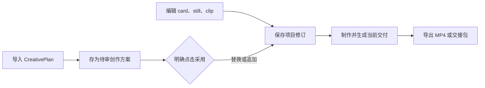
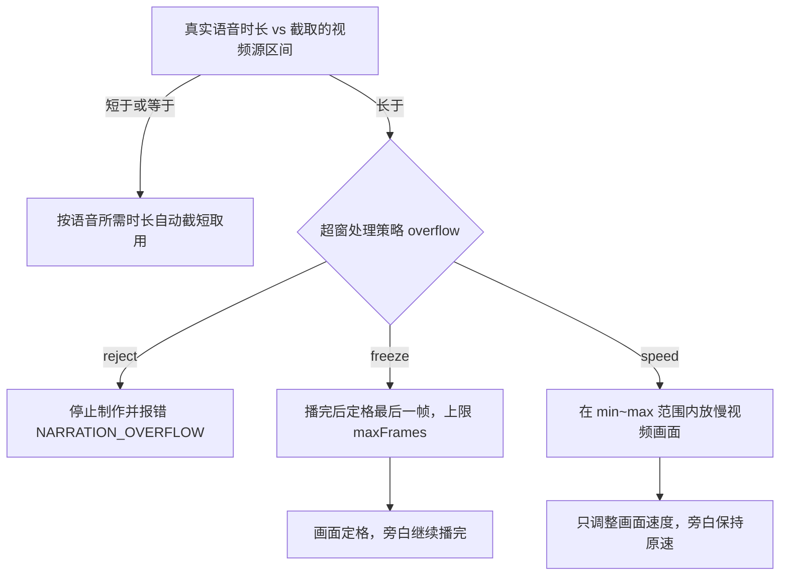

# LightWeaver 的场景、时长与采用

使用 LightWeaver 时，偶尔会遇到“配音比画面长报错了”或者“方案导入了但成片没变”的情况。理解项目如何从草稿变成成片、三种场景怎样计算时长，以及创作方案如何采用，就能把这些问题一下子理顺。

## 一条内容如何变成成片

LightWeaver 把“改内容”、“做视频”和“导文件”拆成三个清晰的阶段：

- **保存修订**：把你当前的场景、文字、旁白和字幕改动存成一个新的项目修订版本（revision）。
- **制作（Build）**：拿一个已保存的修订，结合对应素材、配音和工具链，生成可播放的视频与字幕文件（即“交付”）。
- **导出（Export）**：把已经制作好、验证过的交付文件复制到你指定的位置，或者打包成项目包 / 剪辑工程。导出不会重新渲染，也不会去读还没保存的草稿。



## 三种场景：card、still、clip

LightWeaver 的每一场画面都属于以下三种场景之一，同一个项目里可以自由混用：

- **`card`（文字卡片）**：用内置排版模板渲染出来的纯文字画面，适合片头标题、要点列举和总结收尾，不需要准备外部图片或视频。
- **`still`（静帧图片）**：把一张导入的图片放进画面里（可选完整显示或填满画幅），适合讲解截图、示意图或封面展示。
- **`clip`（视频片段）**：从导入的源视频中截取一段来播放（即“源区间” `sourceRange`），可以选择静音、保留原声、配旁白，或者旁白与原声混音。

| 场景类型 | 画面从哪来 | 时长怎么算 | 常见用途 |
| --- | --- | --- | --- |
| `card` | 内置卡片模板 + 按语言填写的文案 | 固定帧数，或按实际旁白加尾帧 | 标题、要点、总结 |
| `still` | 导入的图片素材 + 画幅适配 | 固定帧数，或按实际旁白加尾帧 | 图解、静帧讲解 |
| `clip` | 导入的视频素材 + 截取起点与时长（源区间） | 按截取时长播放，或按实际旁白加尾帧 | 原声片段、旁白配画面 |

### 时长是怎么计算的

项目的输出帧率决定了帧数和秒数的换算。例如默认 30 fps 下，90 帧就是 3 秒。

- **选择固定帧长（`fixed`）时**：`card` 和 `still` 会严格按照你填的帧数停留，**不会**因为一句较长的旁白而自动拉长。如果实际配音比设定的帧数长，制作会报错，你需要延长时间、精简旁白或改用“按旁白计时”。
- **选择由旁白决定时长（`speech`）时**：系统在制作准备阶段先拿到真实语音时长（无论是 TTS 合成还是导入的旁白音频），再加上你设置的尾帧（`tailFrames`，用于在句末留一点呼吸停顿），以此作为这一场的最终时长。`clip` 也可以选择由旁白长度决定时长，此时你选的视频截取区间只是可用的画面范围上限。

## 旁白超出视频截取范围怎么办

给 `clip` 选了“由旁白音频长度决定”时，你在写文案阶段通常无法精确预知最终念出来有多少秒，因此是否超长是在制作准备阶段、拿到真实语音之后才能确定的。



如果语音比截取的源区间短，系统会按实际需要的时长取用对应片段；如果语音更长，就会按照你为该场景选择的超窗策略（`overflow`）处理：

- **`reject`（报错并保留草稿，默认）**：直接停止制作并报告 `NARRATION_OVERFLOW`，避免在作者不知情的情况下篡改画面节奏。你可以缩短旁白文案、把源区间截长一点，或显式改成下面两种策略。
- **`freeze`（允许有限末帧定格）**：视频播到截取区间末尾后，停在最后一帧等待旁白说完。通过 `maxFrames`（界面上的“最多定格帧数”）限制最多定格多久，超出上限会报错（`FREEZE_LIMIT`）。
- **`speed`（允许调整画面播放速度）**：按比例放慢视频画面的播放速度，让这段素材正好撑满整句旁白；通过 `min` 和 `max`（界面上的“最慢/最快画面速度”）限定允许的速度范围，超出范围会报错（`SPEED_LIMIT`）。注意，速度调整**只作用在视频画面上，不会改变旁白的语速**。

## 素材来源记录（provenance）与字幕状态

有时外部工具或 agent 会先把几段原始视频裁切、拼接或压好字幕，再把预处理后的成片导回 LightWeaver 作为素材。为了让后续编辑者和审片人清楚这段素材是怎么来的，可以在导入时附上 **素材来源记录（`provenance`）**。

`provenance` 会记下：
- 这份素材做了什么处理（`description`）；
- 用到了哪几个精确版本的原始素材、每段承担什么角色（画面、声音、字幕参考或创作参考）及截取区间（`inputs`）；
- 画面本身是否已经烧录了硬字幕（`captions`: `embedded` / `none` / `unknown`）。

这些信息会和不可变的素材版本绑定在一起，并随项目、制作快照和导出的项目包一起保留。需要注意，`provenance` 是作者或 agent 填写的来源登记——它能在 Studio 里提醒你“这段素材的字幕已嵌进画面里，无法在字幕页逐句修改”，但本身不负责校验剪辑或字幕烧录的视觉质量。

## 创作方案（CreativePlan）与场景采用

**创作方案（`CreativePlan`）** 是一份带分场理由和证据索引的结构化草案。当你想先理清全片结构、或者让外部 agent 先提交一版有据可查的方案供你审阅，而不是直接覆盖当前时间轴时，就会用到它。

一份 `CreativePlan` 包含方案标题（`title`）、摘要（`summary`）和至少一个节拍（`beats`）。每个节拍包含三部分：
- `scene`：对应的场景内容（card / still / clip）；
- `rationale`：为什么使用这一场的说明；
- `evidence`：引用的分析证据（纯卡片方案可以为空数组；如果引用分析证据，必须来自当前项目且与对应素材版本和区间匹配）。

从提出方案到进入正式制作，必须经过明确的“保存草案 → 审核 → 采用”三步：

1. **保存草案**：在 CLI 执行 `creative-plan import`（或在 Studio 的 **方案** 页编辑/导入并点 **保存方案蓝图**），会把方案存进新修订，但项目当前用于制作的场景（`scenes`）**不会改变**。
2. **查看审核**：通过 `creative-plan show` 或在 Studio 的 **方案** 页逐节拍查看理由、证据和画面。
3. **显式采用**：只有点击 Studio 中的 **应用到当前场景**（或执行 `creative-plan apply`），方案里的场景才会真正进入项目时间轴（CLI 默认替换现有场景，加 `--append` 可追加并拒绝重复场景 ID）。

> **提示**：并不是所有修改都必须先建 `CreativePlan`。如果你自己在 Studio 里直接增删场景，或者外部 agent 已经掌握了明确结构，可以直接通过界面或 `project apply` / `scene add` 修改当前场景。只有需要记录“分场理由 + 分析证据链路”时，才需要使用创作方案。

## 字段与校验以运行时 Schema 为准

文档和样例只展示常见写法。所有数据结构、必填字段、默认值和校验规则，均以当前工作区 CLI 输出的 JSON Schema 为准：

```text
<完整 CLI 命令> schema scene --json
<完整 CLI 命令> schema ops --json
<完整 CLI 命令> schema creative-plan --json
<完整 CLI 命令> schema media-provenance --json
```

其中 `<完整 CLI 命令>` 可在项目右上角 **更多 → 复制给 agent** 或 **设置 → 诊断与修复 → 运行信息与命令行** 中直接获取，它已经绑定了当前实际的数据目录与配置文件，避免误写到其他工作区。
