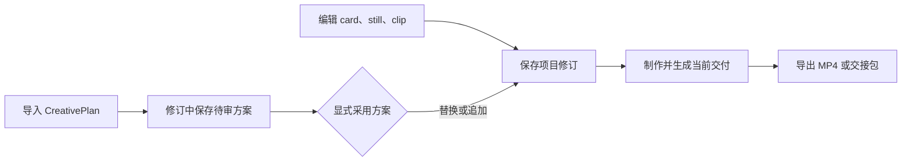
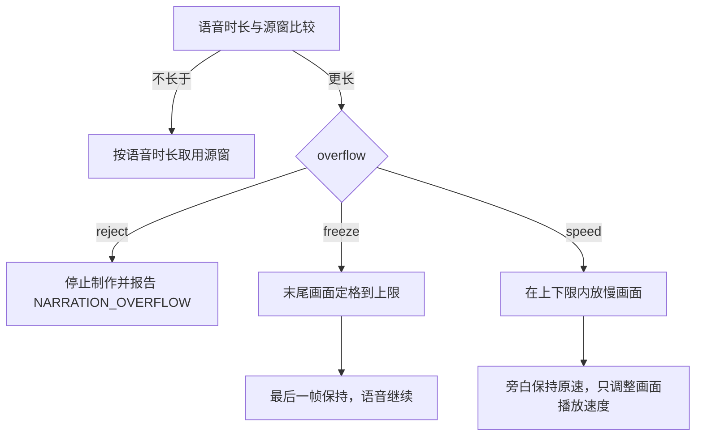

# LightWeaver 的场景、时长与采用

LightWeaver 把创作内容保存为不可变项目修订。制作从某一个修订生成交付，导出把已验证的交付写到目标目录。理解场景如何计时，以及创作方案如何进入项目，能解释大部分“时间对不上”和“方案改了但成片没变”的问题。

## 一条修订如何变成文件



保存解决“项目内容是什么”。制作解决“这个修订在当前素材和工具下能否生成可验证交付”。导出只发布已有交付，不重新解释编辑草稿。

## 三种场景

| 场景 | 画面来源 | 时长来源 | 主要用途 |
| --- | --- | --- | --- |
| card | 注册卡片模板和按语言保存的文案 | 固定帧数，或真实旁白时长加尾帧 | 标题、要点、总结 |
| still | 图片素材版本和画幅适配 | 固定帧数，或真实旁白时长加尾帧 | 讲解、图示、静帧叙事 |
| clip | 视频素材版本，以及起点和微秒源窗 | 选定源窗，或真实旁白时长加尾帧 | 原声片段、旁白覆盖画面 |

输出帧率决定帧数与秒数的关系。默认 30 fps 下，90 帧是 3 秒。卡片和静帧选择固定时长时，画面不会因为一句尚未合成的旁白自动延长。实际旁白超出固定场景时长时，制作会报错，作者需要改时长、缩短文字或改用旁白计时。

卡片和静帧选择旁白计时时，核心先得到真实语音时长，再加作者设置的尾帧。clip 也能由旁白计时。此时旁白成为场景时长的主要依据，源窗只是可用画面范围。

## 旁白超出视频源窗

clip 由旁白计时时，真实语音可能比选定源窗更长。编辑器无法从文案长度可靠推断最终的语音时长，因此冲突在制作准备阶段、拿到真实语音后确定。



`reject` 是默认选择。它要求作者缩短旁白或扩大源窗，避免在没有明确决定时改变画面。

`freeze` 在源窗播放完后保持最后一帧，直到旁白结束。`maxFrames` 限制最多定格多少帧，避免无限拉长。

`speed` 放慢视频画面，让同一段源画面覆盖更长的旁白。`min` 和 `max` 是作者允许的播放速度边界。它不改变旁白语速，也不重新合成语音。若语音更短，核心按所需时长缩短实际取用范围，不进入超窗策略。

## 来源与字幕状态

预处理素材的 provenance 记录使用过哪些精确素材版本、各自承担画面、声音、字幕或参考角色，以及来源字幕是否嵌在画面中。记录进入不可变素材版本，并随项目、制作快照和 bundle 保留。

provenance 是作者提供的来源说明。它证明项目记录了哪些输入，不证明模型匹配、字幕烧录或剪辑结果一定正确。

## 创作方案与场景采用

CreativePlan 包含标题、概述和至少一个 beat。每个 beat 提供 `scene`、`rationale` 和 `evidence`。纯卡片方案可以使用空证据数组。引用分析证据时，证据必须来自当前项目，并匹配素材版本和区间。

方案经历三个阶段：

1. `creative-plan import` 校验并保存方案。它会生成新修订，但当前 `scenes` 继续保持制作使用的内容。
2. `creative-plan show` 读取已保存方案，供人或 agent 审核。
3. `creative-plan apply` 显式采用方案中的场景。默认替换当前场景，`--append` 追加并拒绝重复场景标识。

直接编辑场景不需要先建立 CreativePlan。外部 agent 发现当前上下文足够时，可以通过 `project apply` 提交已确认的 card、still 或 clip。需要记录分场理由和证据链路时，才使用 CreativePlan。

Studio 的方案页也先保存草案，再由用户点击采用。查看方案、导入方案和制作旧场景可以先后发生，只有采用会改变当前场景集合。

## 以运行时合同为准

示例文件用于展示常见结构。字段、必填项、默认值和约束以当前运行时的以下命令为准：

```text
<完整 CLI 命令> schema scene --json
<完整 CLI 命令> schema ops --json
<完整 CLI 命令> schema creative-plan --json
<完整 CLI 命令> schema media-provenance --json
```

完整 CLI 命令由应用的 **复制给 agent** 或设置页生成。它绑定实际数据目录和配置文件，避免把测试项目写到另一个工作区。
